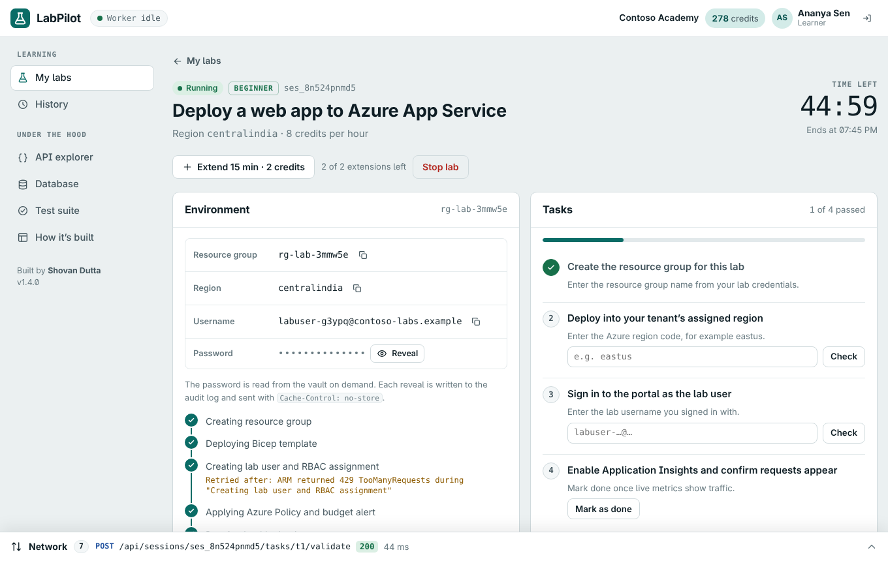
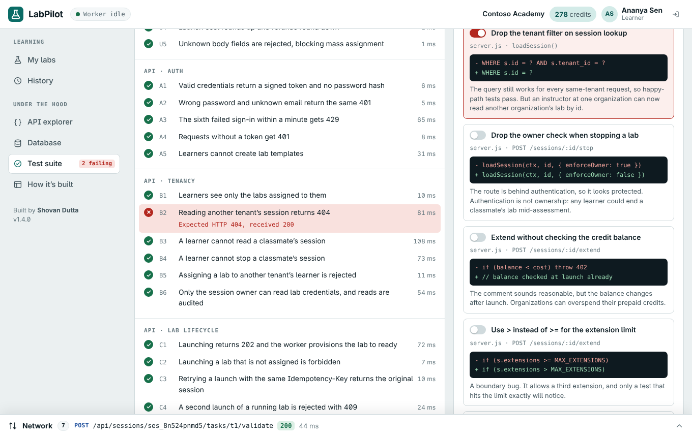

# LabPilot

[](https://github.com/shovand139-maker/labpilot/actions/workflows/ci.yml)

**Live demo: https://shovand139-maker.github.io/labpilot/**

LabPilot is a multi-tenant platform for hands-on cloud labs. Learners launch lab environments that a background worker provisions step by step, pass tasks that are checked against the live lab, and the lab is torn down when its time runs out. Instructors watch the room live and extend or stop labs. Admins manage people and a prepaid credit ledger.

The whole stack (UI, REST API, SQLite database, job worker and test suite) ships as one page, so the demo needs no backend and every visitor gets their own copy of the data.



## Try it

Every demo account uses the password `Labs@2026`.

| Account | Organization | Role | Start here |
|---|---|---|---|
| ananya@contoso.example | Contoso Academy | Learner | Launch a lab, watch it provision, pass its tasks |
| rahul@contoso.example | Contoso Academy | Instructor | Live sessions: extend or stop a learner's lab |
| meera@contoso.example | Contoso Academy | Admin | Credit usage, people, audit log, job queue |
| arjun@fabrikam.example | Fabrikam University | Learner | A second tenant that never sees Contoso data |

Also worth opening:

- **Network bar** at the bottom: every API call with its headers, response and the exact SQL it ran.
- **API explorer**: presets that try to break the API, such as reading another tenant's session (404), editing the token's role (401) or sending a five-hour lab (422).
- **Test suite**: run all 34 tests in the browser, switch on a realistic bug and watch the test that guards it fail.

## How it works

What happens when a learner clicks **Launch**:

1. The UI sends `POST /api/sessions` with an `Idempotency-Key`.
2. Middleware verifies the signed token, checks the learner role and validates the body. Unknown fields are rejected.
3. The handler checks the assignment, any session already running and the credit balance.
4. One transaction inserts the session, debits the ledger, queues a provisioning job and writes the audit entry.
5. The API answers `202 Accepted`, and the UI follows the session as it changes.
6. The worker runs five provisioning steps, retries transient failures with exponential backoff, stores credentials in the vault and marks the lab ready. A sweep expires labs on time and deletes their resources.

| Layer | In this repo | On Azure in production |
|---|---|---|
| Interface | Role-based views; an `html` tagged template that escapes by default | Next.js / React or Angular on Static Web Apps or App Service |
| API | 17 routes; authenticate → role → validate → handler; `application/problem+json` errors; idempotency keys | ASP.NET Core or Next.js route handlers on Container Apps behind Front Door |
| Identity | PBKDF2 password hashes (100k iterations), HMAC-SHA256 tokens with 8-hour expiry, sign-in rate limit | Microsoft Entra ID / Azure AD B2C |
| Data | SQLite (sql.js) with 5 numbered migrations, CHECK constraints, partial unique indexes and a credit ledger | Azure SQL with stored procedures, or PostgreSQL with row-level security |
| Jobs | Polling worker with guarded claims, backoff, expiry sweep and refunds on failure | Service Bus plus Functions or Container Apps jobs |
| Secrets | `vault_secrets` table; sessions keep only a reference; every read is audited | Key Vault with managed identity |
| Observability | Per-request SQL trace; request ids in the audit log | Application Insights and Log Analytics |

## Testing

Each API test boots a fresh in-memory database built by the real migrations, then drives the real API and worker with a fake clock.

| Suite | What it covers |
|---|---|
| Unit | Password hashing, token tampering and expiry, credit maths, mass-assignment rejection |
| API · auth | Login, identical errors for unknown emails, rate limiting, 401 and 403 |
| API · tenancy | Cross-tenant reads, classmates' sessions, credential ownership and auditing |
| API · lab lifecycle | 202 launch to ready, idempotent retries, 409 on duplicates, transient-failure retries, refunds, expiry |
| Spec · lab extension | One test per acceptance criterion (AC-1 to AC-6) |
| Database and UI | `tenant_id` on every tenant table, one active session per learner, XSS-safe rendering |

**Fault injection.** The suite ships with eight plausible-looking bugs. CI switches each one on and fails if no test catches it.

| Injected bug | Caught by |
|---|---|
| Drop the tenant filter on session lookup | B2, E5 |
| Drop the owner check when stopping a lab | B4 |
| Extend without checking the credit balance | E3 |
| Use `>` instead of `>=` for the extension limit | E2 |
| Ignore the `Idempotency-Key` header | C3 |
| Tell users when an email has no account | A2 |
| Remove the sign-in rate limiter | A3 |
| Render lab titles without escaping | D1 (browser) |



**CI** (`.github/workflows/ci.yml`) rebuilds the page and fails if the committed build is stale, then runs the Node suite and fault matrix, a Playwright walk-through of every role in light, dark and phone layouts, and a boot under a strict Content-Security-Policy.

## Project layout

```
src/
  core.js       crypto, SQLite wrapper, migrations, seed data
  server.js     router, middleware, routes, background worker
  tests.js      test suite and injectable faults
  ui-*.js       views, network inspector, API explorer, SQL console, boot
  styles.css    design tokens, light and dark themes
test/           Node runner, Playwright walk-through, CSP check
build.py        bundles src/ into docs/index.html
docs/           the deployable page (served by GitHub Pages)
AGENTS.md       conventions and definition of done for contributors
```

## Run it locally

```bash
npm ci
npm run build          # writes docs/index.html
npm test               # suite + fault matrix in Node
npx playwright install chromium
npm run e2e            # browser walk-through
```

Open `docs/index.html` in a browser to use the app. It loads the SQLite engine and fonts from public CDNs.

## Author

Shovan Dutta · [github.com/shovand139-maker](https://github.com/shovand139-maker)
